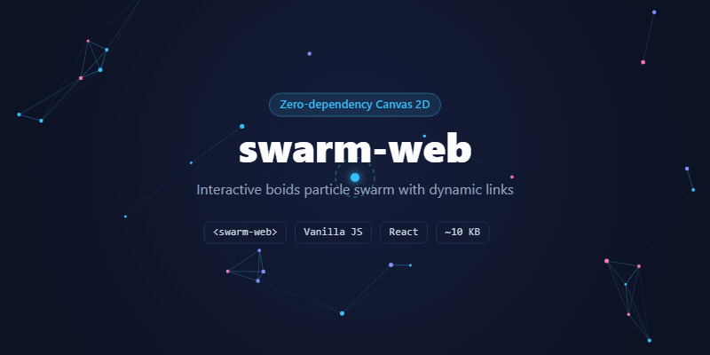

# swarm-web

<p align="center">
  
</p>

ฝูง particle เคลื่อนไหวแบบ **boids** (บินเป็นฝูง มีเส้นเชื่อมระหว่างจุด และตอบสนองต่อเมาส์) สำหรับใส่เป็นพื้นหลังในเว็บไซต์
ไฟล์เดียวจบ ขนาดประมาณ 10 KB วาดด้วย Canvas 2D ไร้ dependency ใช้ได้กับทั้ง HTML ธรรมดา, React, Next.js, Vue, Svelte, Astro, และ Angular

---

## จุดเด่น

- เบาและเร็ว: ขนาดไฟล์รวมประมาณ 10 KB ไม่มี dependency ภายนอก
- ยืดหยุ่น: ใช้งานได้ 3 รูปแบบ คือ Web Component (`<swarm-web>`), JavaScript Class (`SwarmWeb`), และ React Component
- โต้ตอบกับผู้ใช้: อนุภาคตอบสนองต่อการขยับเมาส์ (หนีเมาส์ หรือ วิ่งเข้าหาเมาส์)
- ประหยัดพลังงาน: ระบบจะหยุดเรนเดอร์อัตโนมัติเมื่อเลื่อนหน้าจอพ้นส่วนที่แสดงผล หรือเมื่อสลับแท็บเบราว์เซอร์
- รองรับ SSR: สามารถนำเข้า (import) ในโปรเจกต์ที่รันแบบ Server-Side Rendering ได้อย่างปลอดภัย

---

## การติดตั้งและใช้งาน

### 1. ใช้งานใน HTML ทั่วไปผ่าน CDN

วิธีที่ง่ายที่สุด ไม่ต้องติดตั้ง package เพียงใส่โค้ด script จาก CDN แล้วเรียกใช้แท็ก `<swarm-web>`

```html
<!-- นำเข้าสคริปต์ -->
<script src="https://cdn.jsdelivr.net/gh/bom-sudo/swarm-web@v1.0.0/dist/swarm-web.js" defer></script>

<!-- ใส่ในส่วนหัวหรือกล่องเนื้อหา (ข้อความข้างในจะแสดงทับบนพื้นหลังฝูง particle) -->
<swarm-web colors="#38bdf8,#818cf8" style="min-height: 70vh;">
  <h1>ยินดีต้อนรับสู่เว็บไซต์</h1>
</swarm-web>

<!-- หรือเปิดใช้งานเป็นพื้นหลังเต็มหน้าจอ -->
<swarm-web fullscreen></swarm-web>
```

---

### 2. ใช้งานใน React / Next.js

คัดลอกไฟล์ `react/SwarmWeb.jsx` และ `dist/swarm-web.mjs` ไปวางไว้ในโปรเจกต์ของคุณ

```jsx
import SwarmWeb from './components/swarm-web/SwarmWeb';

export default function HeroSection() {
  return (
    // แสดงเป็น section ความสูง 70vh
    <SwarmWeb as="section" style={{ minHeight: '70vh' }} colors={['#38bdf8', '#818cf8']}>
      <div className="content">
        <h1>หัวข้อหลักของหน้าเว็บ</h1>
        <p>เนื้อหาจะอยู่ด้านบนของพื้นหลัง particle เสมอ</p>
      </div>
    </SwarmWeb>
  );
}
```

หากต้องการให้เป็นพื้นหลังเต็มหน้า:

```jsx
<SwarmWeb fullscreen />
```

---

### 3. ใช้งานด้วย JavaScript (ES Module)

เหมาะสำหรับโปรเจกต์ที่ใช้ Vite, Webpack หรือ Vanilla JS ที่ต้องการควบคุมผ่านโค้ดโดยตรง

```js
import { SwarmWeb } from './dist/swarm-web.mjs';

// กำหนดเป้าหมาย element ที่ต้องการให้แสดงพื้นหลัง
const container = document.querySelector('.hero');

const swarm = new SwarmWeb(container, {
  colors: ['#38bdf8', '#818cf8', '#f472b6'],
  speed: 1,
  interaction: 'repel', // 'repel' (หนีเมาส์) หรือ 'attract' (วิ่งเข้าหา)
});

// ควบคุมการทำงานเพิ่มเติมได้
// swarm.stop();
// swarm.start();
// swarm.setOptions({ speed: 0.5 });
// swarm.destroy();
```

---

### 4. ติดตั้งผ่าน npm จาก GitHub

```bash
npm install github:bom-sudo/swarm-web#v1.0.0
```

```js
import { SwarmWeb } from 'swarm-web';
```

สำหรับ Vue, Svelte, Astro, Angular สามารถดูคู่มือและตัวอย่างเพิ่มเติมได้ใน [AI_INSTALL.md › Recipe C](AI_INSTALL.md#recipe-c--vue--svelte--astro--angular--others)

---

## ตารางการตั้งค่า (Options)

สามารถส่งค่าผ่าน HTML Attribute หรือส่งผ่าน JavaScript Object ได้ดังนี้:

| Attribute | JS Option | ค่าเริ่มต้น | รายละเอียด |
|---|---|---|---|
| `count` | `count` | `auto` | จำนวนจุด (`auto` = ปรับอัตโนมัติตามขนาดหน้าจอ 30 ถึง 180 จุด) |
| `colors` | `colors` | `#38bdf8,#818cf8,#f472b6` | สีของจุด particle |
| `shape` | `shape` | `dot` | รูปทรงของ particle (`dot` = วงกลม, `triangle` = สามเหลี่ยม) |
| `size` | `size` | `2` | รัศมีขนาดของจุด (หน่วยเป็นพิกเซล) |
| `speed` | `speed` | `1` | ความเร็วในการเคลื่อนที่ |
| `link-distance` | `linkDistance` | `110` | ระยะห่างที่จะเชื่อมเส้นระหว่างจุด (`0` คือปิดเส้นเชื่อม) |
| `link-color` | `linkColor` | สีแรกของ colors | สีของเส้นเชื่อม |
| `link-opacity` | `linkOpacity` | `0.35` | ความโปร่งใสของเส้นเชื่อม |
| `link-width` | `linkWidth` | `1` | ความหนาของเส้นเชื่อม (พิกเซล) |
| `interaction` | `interaction` | `repel` | รูปแบบการตอบสนองเมาส์: `repel` (หนีเมาส์), `attract` (เข้าหาเมาส์), `none` (ไม่ตอบสนอง) |
| `interaction-radius` | `interactionRadius` | `140` | รัศมีระยะการตอบสนองต่อเมาส์ (พิกเซล) |
| `opacity` | `opacity` | `1` | ความทึบแสงของทั้งเลเยอร์ (0 ถึง 1) |
| `background` | `background` | `transparent` | สีพื้นหลังของผืนผ้าใบ Canvas |
| `fullscreen` | `fullscreen` | `false` | ตั้งเป็นพื้นหลังแบบเต็มหน้าจอ (position: fixed) |

---

## คำสั่งควบคุมผ่าน JavaScript (Methods)

เมื่อสร้างอินสแตนซ์ด้วย `new SwarmWeb(...)` สามารถเรียกใช้เมธอดต่อไปนี้ได้:

- `swarm.start()`: เริ่มต้นหรือเล่นแอนิเมชันต่อ
- `swarm.stop()`: หยุดการเคลื่อนไหวชั่วคราว (ภาพจะค้างไว้ที่เฟรมล่าสุด)
- `swarm.setOptions(newOptions)`: ปรับแต่งค่าตัวเลือกใหม่ได้ทันทีขณะกำลังทำงาน
- `swarm.destroy()`: ลบ Canvas ออกจากหน้าเว็บ และคืนค่าทรัพยากรทั้งหมด

---

## การให้ AI ช่วยติดตั้งในโปรเจกต์ของคุณ

หากคุณใช้งานเครื่องมือ AI เช่น Cursor, Claude Code, GitHub Copilot หรือ Codex สามารถคัดลอกข้อความด้านล่างนี้ไปสั่ง AI ได้ทันที:

```text
ใส่ swarm-web ในเว็บนี้ ทำตาม https://raw.githubusercontent.com/bom-sudo/swarm-web/main/AI_INSTALL.md
```

AI จะอ่านข้อกำหนดจาก [AI_INSTALL.md](AI_INSTALL.md) และดำเนินการเลือกตำแหน่ง วางไฟล์ และปรับสีให้เข้ากับธีมของเว็บไซต์โดยอัตโนมัติ

---

## คำสั่งสำหรับนักพัฒนา

```bash
npm run build   # คอมไพล์ src/swarm-web.js ไปยังโฟลเดอร์ dist/
npm test        # รันการทดสอบระบบจำลอง particle
npm run demo    # เปิดหน้าตัวอย่าง http://localhost:3000/demo/
```

- การแก้ไขโค้ดหลักให้แก้ที่ไฟล์ `src/swarm-web.js` จากนั้นรัน `npm run build` ทุกครั้ง
- โฟลเดอร์ `dist/` จะถูกเก็บไว้ใน repository เพื่อให้สามารถดึงไปใช้งานผ่าน CDN ได้ทันที

---

## License

MIT License
